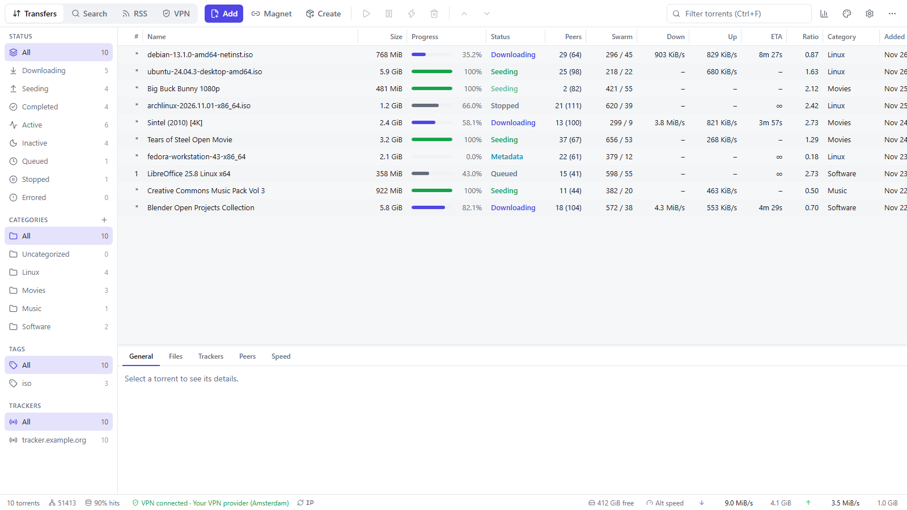
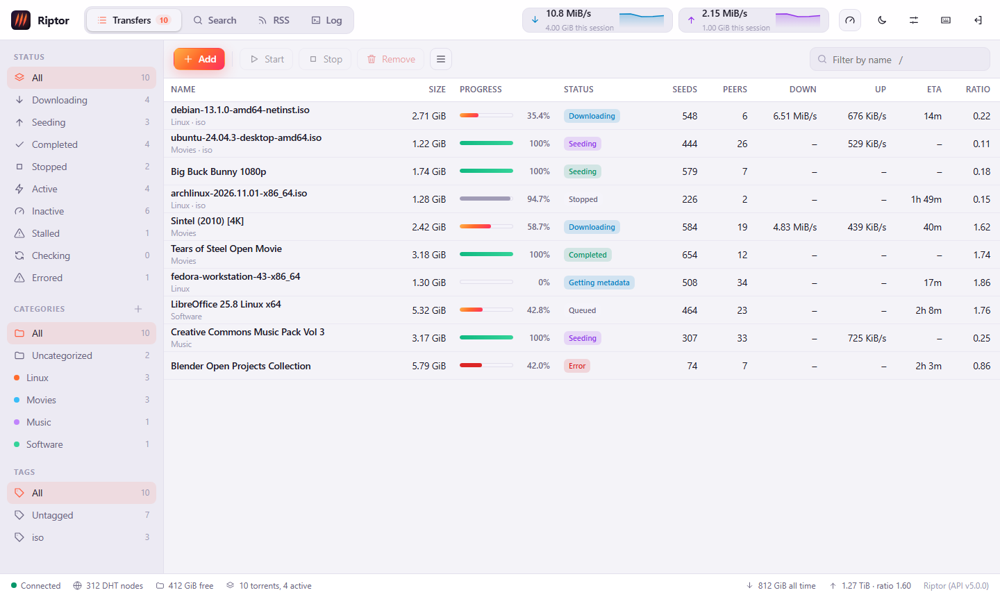

<div align="center">


# Riptor

**A BitTorrent client for Windows and Linux, with built-in search, an app-only VPN and a web interface.**

[](https://github.com/gokulbits/riptor/actions/workflows/ci.yml)
[](https://github.com/gokulbits/riptor/actions/workflows/docker.yml)
[](https://github.com/gokulbits/riptor/releases)

[](LICENSE)

[Install](#installation) · [Features](#features) · [Usage](#usage) · [Docker](#docker) · [Security](#security) · [FAQ](#faq) · [Contributing](#contributing)

<br>

<picture>
  <source media="(prefers-color-scheme: dark)" srcset="docs/screenshots/app-dark.png">
  
</picture>

<sub>The desktop app, shown in your GitHub theme. The <a href="#web-interface-and-remote-control">web interface</a> has the same features in a browser.</sub>

</div>

> [!NOTE]
> Riptor is in early development. Downloading, seeding, search, statistics and backups work and are covered by tests. The app-only VPN has not been tested against a real VPN provider, and the installers have not been tried on clean machines. Please [report what you find](https://github.com/gokulbits/riptor/issues).

## Why Riptor

Riptor is a torrent client built on a Rust engine ([librqbit](https://github.com/ikatson/rqbit)) with a Tauri shell, so there's no bundled browser. It does what a torrent client should, plus three things most don't:

- **Search is built in.** Internet Archive, Torznab indexers and nova3-compatible Python plugins, queried in parallel.
- **The VPN only covers Riptor.** Import an OpenVPN profile from your provider and only Riptor's sockets use the tunnel. Your browser keeps its normal connection and your computer's default route is never touched. A kill switch holds every torrent while the tunnel is down.
- **External input is treated as hostile.** Torrent metadata, peers, trackers, search results, plugins, backups and VPN profiles are all validated in Rust, with tests that prove the attacks fail.

## Contents

- [Quick start](#quick-start)
- [Installation](#installation): [Windows](#windows) · [Linux](#linux) · [Docker](#docker) · [Headless](#headless-linux)
- [Features](#features)
- [Usage](#usage): [Adding torrents](#adding-torrents) · [Search](#search) · [VPN](#vpn) · [Moving from qBittorrent](#moving-from-qbittorrent) · [Web interface and remote control](#web-interface-and-remote-control) · [Backups](#backups)
- [Configuration](#configuration)
- [Security](#security)
- [FAQ](#faq)
- [Development](#development)
- [Contributing](#contributing) · [Acknowledgements](#acknowledgements) · [License](#license)

## Quick start

**Desktop:** download the setup or package for your system from the [latest release](https://github.com/gokulbits/riptor/releases/latest), install it and add a magnet link or `.torrent` file.

**Server or NAS:** run the Docker image and open `https://<server IP>:8080` in a browser.

```bash
docker run -d --name riptor --init --restart unless-stopped \
  -v ./config:/config -v ./downloads:/downloads \
  -p 8080:8080 -p 6881:6881 -p 6881:6881/udp \
  ghcr.io/gokulbits/riptor:latest
docker logs riptor   # the first start prints a password for user admin
```

## Installation

Every release on the [releases page](https://github.com/gokulbits/riptor/releases) ships installers, a Docker image and `SHA256SUMS.txt`. You never need to install anything else for a Riptor feature.

| Platform | File | Install |
| --- | --- | --- |
| Windows 10/11 (64-bit) | `Riptor_<version>_x64-setup.exe` | Run the setup |
| Debian 12+, Ubuntu 22.04+ | `Riptor_<version>_amd64.deb` | `sudo apt install ./Riptor_<version>_amd64.deb` |
| Fedora 36+, openSUSE | `Riptor-<version>-1.x86_64.rpm` | `sudo dnf install ./Riptor-<version>-1.x86_64.rpm` |
| Docker (amd64, arm64) | `ghcr.io/gokulbits/riptor` | See [Docker](#docker) |

Check what you downloaded:

```bash
sha256sum -c SHA256SUMS.txt --ignore-missing
```

### Windows

The setup installs for all users and silently installs the OpenVPN command-line client (unless it's already there). It also carries its own copy of Python for search plugins, kept inside Riptor's folder and off your `PATH`. Uninstalling Riptor leaves OpenVPN alone, since other programs may use it.

Release builds aren't code-signed, so SmartScreen warns the first time you run the setup. Check the hash, then choose **More info** and **Run anyway**. Riptor updates itself in place once installed.

### Linux

The packages pull in `openvpn`, `pkexec`, `python3` and `bubblewrap`, and install a polkit policy so Riptor can ask for administrator rights when you connect the VPN.

Riptor needs **webkit2gtk 4.1** (`libwebkit2gtk-4.1-0`), the system WebView it's built on. Ubuntu 22.04, Debian 12 and Fedora 36 are the first releases with it; Ubuntu 20.04 and Debian 11 only ship 4.0, so apt reports `Depends: libwebkit2gtk-4.1-0 but it is not installable` there and an upgrade is the only fix.

### Docker

The image runs Riptor headless with the web interface and remote control on, for a home server or NAS. [docker/compose.yaml](docker/compose.yaml) is a ready-made setup:

```yaml
services:
  riptor:
    image: ghcr.io/gokulbits/riptor:latest
    container_name: riptor
    init: true
    restart: unless-stopped
    environment:
      PUID: "1000"
      PGID: "1000"
      # RIPTOR_WEBUI_PASSWORD: change-me-please
    volumes:
      - ./config:/config
      - ./downloads:/downloads
    ports:
      - "8080:8080"
      - "6881:6881"
      - "6881:6881/udp"
```

Unless you set a password, the first start makes one and prints it once in `docker logs riptor`. Open `https://<server IP>:8080`, accept the self-signed certificate and sign in as `admin`, or add the address in an app that speaks qBittorrent's Web API. The command line works inside the container too:

```bash
docker exec riptor riptor-cli add 'magnet:?xt=urn:btih:...'
```

To build the image yourself: `docker build -t riptor .`. Every option is in [Configuration](#configuration).

### Headless (Linux)

The Linux packages include `riptord`, which runs without a window, and `riptor-cli`, which controls it over a private local socket with no network port. Its data lives in `~/.local/share/riptor-headless`, separate from the desktop app.

```bash
systemctl --user enable --now riptord
riptor-cli add 'magnet:?xt=urn:btih:...' --dir ~/Downloads
```

`riptor-cli --help` lists the commands and `riptor-cli <command> --help` explains one. Start it with `RIPTOR_WEBUI=on` (and a password, see [Configuration](#configuration)) to get the web interface. Headless mode has no VPN.

## Features

<table>
<tr><td width="50%" valign="top">

**Downloading and seeding**
- `.torrent` files, magnet links, info hashes and torrent URLs, by drag and drop, paste or dialog
- Per-torrent and global speed limits, with a weekly schedule for the alternative ones
- Queueing and share limits (ratio, seeding time, inactive time)
- Categories with default folders, tags and watched folders
- File priorities, renaming, moving, force recheck, an incomplete-downloads folder
- Sequential or rarest-first order; audio and video play while they download
- A piece map and torrent creation

</td><td width="50%" valign="top">

**Search**
- Internet Archive, Torznab indexers and nova3 plugins in parallel
- Seed and peer counts looked up from trackers when an engine doesn't give them
- Plugin catalog with each plugin's source and SHA-256 shown before installing
- Plugins run isolated: `python -I`, a cleared environment, limits, bubblewrap on Linux

</td></tr>
<tr><td valign="top">

**Privacy and the VPN**
- App-only OpenVPN tunnel (WireGuard too on Linux) with a kill switch
- Searches, scrapes, plugins, RSS and DNS all go through the tunnel
- A leak check and a ledger of every host contacted this session
- Peer encryption (MSE/PE) on by default; IP blocklists and peer bans

</td><td valign="top">

**Trust and safety**
- Flags fake-release tricks: hidden characters, `movie.mp4.exe`, "codec" installers, password-in-a-text-file archives
- Dangerous-looking torrents are added stopped; programs are never opened
- Verifies `SHA256SUMS`, `.sfv` and `.md5` files shipped with a torrent
- Re-reads what you seed in the background to catch a failing disk
- Strips tracker passkeys from copied magnets and exported `.torrent` files

</td></tr>
<tr><td valign="top">

**Automation**
- RSS and Atom feeds with download rules (words or regular expressions, per feed)
- Monthly data cap, pausing on metered connections, a free-space guard
- Sleep or shut down when everything finishes
- Reuses files other torrents already have, proven by piece hashes

</td><td valign="top">

**Everywhere you are**
- A web interface for any browser, with a phone layout and dark and light themes
- Remote control from apps that speak qBittorrent's Web API, search and RSS included
- Headless `riptord` with `riptor-cli`, and a Docker image for amd64 and arm64
- In-app updates on Windows; tray icon with live speeds

</td></tr>
</table>

Also: encrypted, tamper-evident backups; a statistics page with a 30-day chart; nine themes and custom accents; a storage engine that buffers pieces in memory, shares a read-ahead cache while seeding and pools file handles; web seeds (BEP 19); and "open with" registration for `.torrent` files and magnet links.

## Usage

### Adding torrents

Use **Add** for a `.torrent` file or **Magnet** for links and URLs. You can also drop files on the window, paste a magnet link or info hash anywhere, or open one from your browser. Everything goes through the add dialog, where you pick the files, the folder, a category and tags. Right-click a torrent for pause, force start, share limits, queue position and the rest; double-click to open its folder.

<details>
<summary><b>Keyboard shortcuts</b></summary>

| Shortcut | Action |
| --- | --- |
| <kbd>Ctrl</kbd>+<kbd>O</kbd> | Add a torrent file |
| <kbd>Ctrl</kbd>+<kbd>U</kbd> | Add magnet links or URLs |
| <kbd>Ctrl</kbd>+<kbd>V</kbd> | Add whatever's on the clipboard |
| <kbd>Ctrl</kbd>+<kbd>F</kbd> | Filter the list |
| <kbd>Ctrl</kbd>+<kbd>K</kbd> | Open search |
| <kbd>Space</kbd> | Stop the selection, or resume it if all stopped |
| <kbd>Enter</kbd> | Open the focused torrent's folder |
| <kbd>Delete</kbd> | Remove the selection |

The web interface has its own; press the keyboard button in its top bar to see them.

</details>

### Search

Open the **Search** tab and choose **Search engines** to add a Torznab indexer (feed URL and API key) or install plugins from the catalog or a URL. Plugins are third-party code, so Riptor shows each one's source and SHA-256 before installing, and runs them isolated. Right-click a result for its files, size and trackers, to download it in one step, or to open its page.

### VPN

1. Download an OpenVPN profile (`.ovpn`) from your provider, from a server that allows P2P.
2. In the **VPN** tab, choose **Import .ovpn / .conf**.
3. Enter the OpenVPN username and password if the profile needs them. Most providers issue these separately from your account login; they go in your system's credential store.
4. **Connect**, and approve the administrator prompt: creating the tunnel adapter needs it.
5. Turn on the **kill switch** so torrents never run outside the tunnel.

<details>
<summary><b>What goes through the tunnel</b></summary>

Searches, tracker scrapes, plugin requests, RSS and `.torrent` URLs go through the tunnel too; indexers on your own machine or LAN stay direct. With the kill switch on and the VPN down there's no DHT, no listening port, no trackers, no peers and no searches. A leak check compares the address trackers and peers see with your normal one, and peers that report seeing your real address will hold torrents until you've looked. The **connections ledger** lists every host Riptor contacted this session and whether it went through the tunnel; it's kept in memory only. UPnP and local peer discovery are off while the VPN is in use; NAT-PMP forwarding is there if your provider supports it.

</details>

### Moving from qBittorrent

Riptor takes over your torrents without downloading anything again.

1. In qBittorrent, pause the torrents that are still downloading, or close it. Seeding ones can keep going.
2. In Riptor, open the three-dot menu and choose **Import from qBittorrent**. It finds them itself.
3. **Import.** Each torrent keeps its folder, category, tags, downloaded and uploaded totals, seeding time and share limits, and qBittorrent's all-time totals are added to Riptor's statistics. Files are checked where they are.
4. Once you're happy, remove the torrents in qBittorrent and keep the files. Don't run the same torrent in both apps.

<details>
<summary><b>If it can't find them</b></summary>

With a portable install for example, click **Choose folder** and pick qBittorrent's `BT_backup`:

- Windows: `%LOCALAPPDATA%\qBittorrent\BT_backup`
- Linux: `~/.local/share/qBittorrent/BT_backup`, or `~/.var/app/org.qbittorrent.qBittorrent/data/qBittorrent/BT_backup` for the Flatpak

Importing twice is safe: torrents already in Riptor are left alone and totals aren't counted again.

</details>

### Web interface and remote control

Riptor has its own web interface for any browser, and speaks qBittorrent's Web API so apps like qBitController manage it over your network. It's off by default in the desktop app.

<p align="center">
  <picture>
    <source media="(prefers-color-scheme: dark)" srcset="docs/screenshots/web-interface-dark.png">
    
  </picture>
</p>

1. In **Settings > Remote Control**, turn on **Allow remote control**, set a password, save.
2. Open `https://<this computer's IP>:8080` in a browser and sign in, or add that address as a server in your app with your username (`admin` unless you changed it) and the password.
3. Accept the self-signed certificate (in apps, "trust self-signed certificates"): Riptor makes its own unless you give it one.

The web interface covers the torrent list with filters, details (files and priorities, trackers, peers, pieces), adding by link, file or drag and drop, search across your engines, RSS feeds and download rules, the log and the main options. Apps get the same through the API: search and search plugins, RSS with rules, the log and preferences.

Only devices on your local network are accepted unless you allow more, and never anything arriving through the VPN tunnel. Every call needs a sign-in, unless you turn on one of the bypass options. Remote clients can't change remote control's own settings, shut Riptor down or browse its folders, and can install search plugins only if you allow it, since plugins run as code on this computer. RSS folders, episode filters and a few qBittorrent-only switches answer "not supported".

### Backups

**Settings > Backup & restore** writes a `.riptorbackup` file holding your torrents, settings, categories and statistics, restorable on any Riptor install. Add a password for real protection: without one the file is only tamper-evident.

## Configuration

The desktop app is configured in **Settings**. Headless mode and Docker read `settings.json` in their data folder and take these environment variables (`PUID`, `PGID`, `UMASK` and `TZ` are Docker only):

| Variable | Default | What it does |
| --- | --- | --- |
| `PUID`, `PGID` | `1000` | The user and group Riptor runs as, and who owns `/config` and new downloads |
| `UMASK` | `022` | Permissions for new files (`002` lets the group write) |
| `TZ` | UTC | Time zone, for the speed schedule |
| `RIPTOR_DOWNLOAD_DIR` | `/downloads` | Where torrents are saved |
| `RIPTOR_INCOMPLETE_DIR` | | Keeps unfinished downloads here and moves them when done |
| `RIPTOR_WATCH_DIR` | | `.torrent` files put here are added |
| `RIPTOR_PEER_PORT` | `6881` | The BitTorrent port (TCP and UDP); publish the same port |
| `RIPTOR_WEBUI` | `on` | The web interface and remote control |
| `RIPTOR_WEBUI_PORT` | `8080` | Its port (1024 and up) |
| `RIPTOR_WEBUI_USERNAME` | `admin` | Its user name |
| `RIPTOR_WEBUI_PASSWORD` | | Its password (8 to 256 characters) |
| `RIPTOR_WEBUI_PASSWORD_FILE` | | Reads the password from a file instead, such as a Docker secret |
| `RIPTOR_WEBUI_HTTPS` | `on` | Turn off only behind a reverse proxy that adds HTTPS |
| `RIPTOR_WEBUI_TRUSTED_PROXIES` | | Reverse proxies (IPs or CIDR ranges) whose `X-Forwarded-For` is believed |
| `RIPTOR_WEBUI_PLUGIN_INSTALL` | `off` | Lets remote clients install and update search plugins |

A variable that's set wins over `settings.json` at every start. Everything else (speed limits, seeding rules, categories, RSS) lives in `/config/settings.json` and the rest of `/config`, or in the web interface's options; stop the container before editing files by hand. Run with `--user 1000:1000` instead of `PUID`/`PGID` if the container should never start as root.

## Security

The full threat model, and how to report a vulnerability privately, are in [SECURITY.md](SECURITY.md). The short version:

- Every file path in a torrent is rebuilt and proven to stay inside the save folder, including Windows drive prefixes, reserved device names, alternate data streams and `..`.
- Save folders can never be system folders, startup folders, `~/.ssh` or Riptor's own data.
- Downloads are never opened automatically. On Windows, finished files get a Mark-of-the-Web so SmartScreen and Office treat them as internet files.
- Search plugins install only after you confirm, and run with `python -I`, a cleared environment, time and output limits, and bubblewrap on Linux.
- VPN profiles have scripts, plugins and file references removed or refused. The small elevated helper accepts one fixed request and re-checks every profile before OpenVPN reads it.
- Web seeds must be http(s) on public addresses (checked after DNS and every redirect), with exact lengths and hash checks on every piece.
- API keys and VPN credentials live in the OS credential store, never in files or backups. Backups use XChaCha20-Poly1305 with an optional Argon2id password, and restores re-validate everything.
- No server listens unless you turn on remote control. Its passwords are Argon2id hashes, guessing is limited per client and across all clients, and the web interface runs under a strict Content Security Policy.

<details>
<summary><b>Honest limits</b></summary>

- Peer encryption (MSE/PE) is obfuscation, not privacy: RC4 with an unauthenticated key exchange, so anyone in the middle can still read it. Tested between Riptor sessions, not yet against other clients.
- Fake-release checks are heuristics. They catch common tricks, not malware.
- On the VPN, plugins reach the web through a local proxy bound to the tunnel. A plugin that opens its own sockets would bypass it.
- Web seeds are skipped while a SOCKS5 proxy or anonymous mode is on, since they'd bypass it.
- The update check uses its own connection and never goes through the VPN. The ledger shows it.
- What peers claim to see can be made up, so the swarm check needs several unrelated sources.
- Metered state and network names come from Windows or NetworkManager (`busctl`). Without them a network counts as untrusted.
- In Docker, plugins run without the bubblewrap sandbox (Docker's default security profile blocks it), with the container as their only fence.

</details>

## FAQ

<details>
<summary><b>Windows warns that the setup is from an unknown publisher.</b></summary>

Release builds aren't code-signed. Check the file against `SHA256SUMS.txt` from the same release, then choose **More info** and **Run anyway**.

</details>

<details>
<summary><b>The .deb won't install on Ubuntu 20.04 or Debian 11.</b></summary>

Riptor needs webkit2gtk 4.1, which those releases don't have and which isn't backported. Ubuntu 22.04, Debian 12 or Fedora 36 and newer work; so does the Docker image.

</details>

<details>
<summary><b>Can the Docker image use the VPN?</b></summary>

Not by itself: like headless mode, the container has no VPN or kill switch. Run it inside a VPN container's network (`network_mode: service:<vpn>` in compose) and publish the ports there.

</details>

<details>
<summary><b>Do search plugins and Torznab work in Docker?</b></summary>

Plugins do; Python is in the image, but they run without the sandbox (see [Honest limits](#security)). Torznab indexers need a system keyring for their API keys, which the image doesn't have yet.

</details>

<details>
<summary><b>I lost the web interface password.</b></summary>

In the desktop app, set a new one in **Settings > Remote Control**. In Docker, set `RIPTOR_WEBUI_PASSWORD` and restart the container.

</details>

## Development

You'll need [Rust](https://rustup.rs/) (stable) and [Node.js](https://nodejs.org/) 22+. On Windows, Visual Studio 2022 Build Tools with "Desktop development with C++"; WebView2 ships with Windows 11. On Debian/Ubuntu:

```bash
sudo apt-get install libwebkit2gtk-4.1-dev libappindicator3-dev librsvg2-dev patchelf libssl-dev
```

Then run the app in development mode:

```bash
npm ci && cargo build -p riptor-vpn-helper && npx tauri dev
```

The VPN helper has to sit next to the Riptor executable, which is what the middle step is for. Search plugins in a dev build use Python 3.9+ from your `PATH`; on Windows the **Search engines** dialog can set up a private copy.

Checks, all of which must be clean:

```bash
cargo test --workspace && npm test && cargo clippy --workspace --all-targets -- -D warnings && cargo fmt --all --check && npx tsc -b --noEmit && npm run lint
```

<details>
<summary><b>Building the installers</b></summary>

1. Fetch the bundled third-party installers (Windows only; both scripts verify pinned SHA-256 hashes):
   ```bash
   node scripts/fetch-openvpn.mjs && node scripts/fetch-python.mjs
   ```
2. Build the helper: `cargo build --release -p riptor-vpn-helper`.
3. Copy `target/release/riptor-vpn-helper(.exe)` into `src-tauri/binaries/` as `Riptor VPN Service-<target-triple>.exe` on Windows (that name is what the admin prompt shows) or `riptor-vpn-helper-<target-triple>` on Linux. `rustc -vV` prints your target triple. On Linux also build `riptor-daemon` and copy `riptord` and `riptor-cli` there with the same suffix.
4. On Windows, set `TAURI_SIGNING_PRIVATE_KEY` to the updater key (content or path) so the setup is signed for the in-app updater.
5. Build:
   ```bash
   npx tauri build --config src-tauri/tauri.bundle.conf.json --config src-tauri/tauri.bundle.windows.conf.json
   ```
   Leave out the second `--config` on Linux.

If it fails with "NASM command not found" (from `aws-lc-sys`), set `AWS_LC_SYS_PREBUILT_NASM=1` or install NASM.

</details>

<details>
<summary><b>Making a release</b></summary>

CI runs formatting, clippy, tests and security checks (`cargo-deny`, `npm audit`) on Windows and Linux for every push and pull request, and builds and smoke-tests the Docker image for amd64 and arm64. Installers build only for version tags and manual runs.

1. Bump `version` in `Cargo.toml`, `package.json` and `src-tauri/tauri.conf.json`.
2. Tag it: `git tag -a v0.1.9 -m "Riptor 0.1.9" && git push origin v0.1.9`.
3. CI makes a **draft** release with the installers, `SHA256SUMS.txt` and the `latest.json` the updater reads, after checking the files match the tag.
4. Review and publish. Installed copies offer the update once it's public, and publishing pushes the Docker image to `ghcr.io/gokulbits/riptor`.

A tag with a hyphen in it (`v0.2.0-beta.1`) becomes a pre-release, and its Docker image doesn't move `latest`.

</details>

## Contributing

Bug reports, ideas and pull requests are welcome.

- **Bugs and features:** open an [issue](https://github.com/gokulbits/riptor/issues) with your OS, the Riptor version and steps to reproduce.
- **Security:** don't open a public issue. Follow [SECURITY.md](SECURITY.md).
- **Pull requests:** make the [checks](#development) pass. Anything that handles external input needs a test showing the attack fail.

## Acknowledgements

- [librqbit](https://github.com/ikatson/rqbit), the BitTorrent engine Riptor is built on.
- [Tauri](https://tauri.app/), [React](https://react.dev/) and [Tailwind CSS](https://tailwindcss.com/).
- [OpenVPN Community](https://openvpn.net/community/) and [Python](https://www.python.org/), bundled with the Windows setup under their own licenses. See [THIRD-PARTY-NOTICES.md](THIRD-PARTY-NOTICES.md).
- [IP geolocation by DB-IP](https://db-ip.com) (CC BY 4.0) for peer countries.
- [Claude Code](https://claude.com/claude-code), which helped build Riptor.

## License

Riptor is MIT licensed, see [LICENSE](LICENSE). Bundled third-party software keeps its own license ([THIRD-PARTY-NOTICES.md](THIRD-PARTY-NOTICES.md)).
